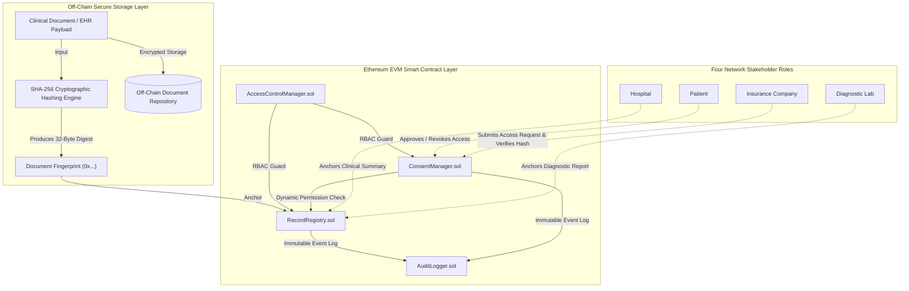
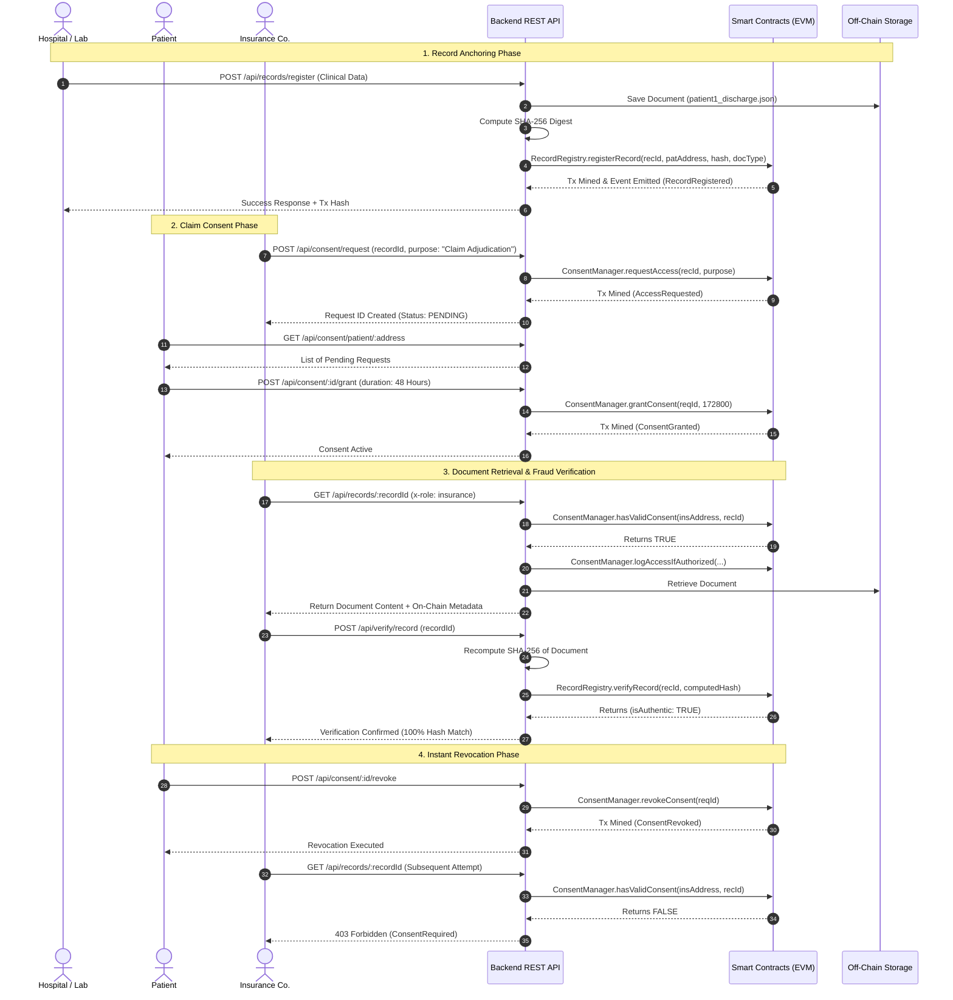

# MediLedger: Technical Architecture & System Documentation

**Project Title:** Blockchain-Based Patient-Controlled Medical Record Authentication and Consent Management Network  
**Degree Track:** MBA in Finance / Technology Management  
**Academic Domain:** Health Information Exchange (HIE), Decentralized Identity, FinTech & Healthcare Insurance Fraud Mitigation  
**Version:** 1.0.0 (Production-Ready Proof of Concept)  
**Date of Submission:** November 2026  

---

## 1. Executive & Technical Abstract

Modern healthcare data exchange suffers from two acute structural problems:
1. **Payer-Provider Fraud & Alteration:** Insurance providers globally lose 10–15% of annual claim disbursements to inflated hospital bills, phantom billing, and post-issuance modification of medical summaries.
2. **Patient Data Disenfranchisement:** Patients lack granular, autonomous, and time-bound consent controls over their medical records, violating the spirit of modern data privacy frameworks (such as the Indian Digital Personal Data Protection Act 2023 and the EU GDPR).

**MediLedger** resolves this dilemma through a **hybrid off-chain/on-chain architecture**. Medical records (clinical discharge summaries, diagnostic pathology reports, MRI imaging) remain stored in high-performance off-chain repositories, while cryptographic **SHA-256 fingerprints**, role-based authorizations, and granular consent states are immutably anchored on an **Ethereum EVM-compatible blockchain**.



---

## 2. Technology Stack & Environment Specifications

| Component | Technology | Version | Purpose |
|---|---|---|---|
| **Smart Contracts** | Solidity | `^0.8.20` | EVM smart contracts with strict reentrancy protection and role access control |
| **Blockchain Devnet** | Hardhat | `^2.22.18` | In-memory local EVM blockchain with automated transaction mining (Chain ID: 31337) |
| **Blockchain Client** | Ethers.js | `^6.11.1` | JSON-RPC contract interaction, wallet abstraction, transaction signing |
| **Backend Runtime** | Node.js / Express | `v26.13.1` / `4.19.2` | REST API gateway, off-chain storage coordinator, canonical hashing engine |
| **Frontend Framework** | React + Vite | `18.2.0` / `5.4.21` | High-performance single page application (SPA) |
| **Styling** | Tailwind CSS | `3.4.1` | Responsive enterprise healthcare dashboard interface |
| **Hashing Engine** | Node.js Crypto (FIPS 180-4) | Native | Cryptographic SHA-256 fingerprint generation |
| **Icons** | Lucide React | `0.363.0` | Modern SVG iconography |

---

## 3. Cryptographic Architecture & Fingerprinting Pipeline

### 3.1 The Hybrid Storage Principle
Storing entire medical files (e.g., 20 MB MRI scans or 200 KB clinical summaries) directly on-chain is economically and technically prohibitive:
- Ethereum gas costs for on-chain storage scale at $\approx 20,000\text{ gas}$ per 32-byte storage slot.
- Storing unencrypted Protected Health Information (PHI) directly on a public or consortium ledger directly violates data privacy regulations (DPDP Act, HIPAA, GDPR) due to ledger immutability and lack of "Right to be Forgotten" erasure capability.

**The Solution:**
MediLedger anchors only the **32-byte SHA-256 digest** (`bytes32`) on-chain. If an off-chain record is later deleted upon a patient's formal erasure request, the on-chain hash remains solely as an anonymous historical mathematical timestamp, revealing zero health data.

### 3.2 Canonical JSON Hashing
To prevent false-positive hash mismatches caused by inconsistent JSON key ordering or whitespace discrepancies, MediLedger utilizes a canonical serialization algorithm before computing the SHA-256 digest:

$$\text{CanonicalHash} = \text{SHA-256}\left(\text{Serialize}_{\text{sorted-keys}}(\text{ClinicalPayload})\right)$$

```javascript
function canonicalJsonStringify(obj) {
  if (obj === null || typeof obj !== "object") return JSON.stringify(obj);
  if (Array.isArray(obj)) return "[" + obj.map(canonicalJsonStringify).join(",") + "]";
  const sortedKeys = Object.keys(obj).sort();
  const pairs = sortedKeys.map(k => JSON.stringify(k) + ":" + canonicalJsonStringify(obj[k]));
  return "{" + pairs.join(",") + "}";
}
```

---

## 4. Smart Contract Architecture

MediLedger is composed of four modular Solidity contracts:

```
blockchain/contracts/
├── AccessControlManager.sol   # Role-Based Access Control (RBAC) & Entity Identity
├── AuditLogger.sol            # Immutable Append-Only Event Trail
├── RecordRegistry.sol         # Document Fingerprint Storage & Verification
└── ConsentManager.sol         # Patient-Centric Time-Bound Consent Engine
```

### 4.1 AccessControlManager.sol
Governs stakeholder authorization. Only registered entities can execute critical operations.
- **Roles:**
  * `1: PATIENT` — Natural person, data owner.
  * `2: HOSPITAL` — Accredited healthcare facility (e.g., Apollo Hospitals).
  * `3: DIAGNOSTIC_LAB` — Certified diagnostic imaging/pathology laboratory (e.g., Metro PathLabs).
  * `4: INSURANCE_COMPANY` — Licensed health insurance provider (e.g., Star Health Insurance).
- **Key Methods:**
  * `registerEntity(address wallet, uint8 roleNumber, string name, string identifier)`
  * `setEntityStatus(address wallet, bool isActive)`
  * `isHospital(address)`, `isLab(address)`, `isInsurance(address)`, `isPatient(address)`

### 4.2 RecordRegistry.sol
Maintains the cryptographic fingerprint index.
- **Data Structure:**
  ```solidity
  struct MedicalRecord {
      string recordId;
      address patient;
      address issuer;
      bytes32 documentHash;
      string docType;
      string offchainURI;
      uint256 createdAt;
      bool isActive;
  }
  ```
- **Key Methods:**
  * `registerRecord(...)`: Callable only by registered Hospitals and Diagnostic Labs. Validates that recordId and documentHash are unique.
  * `verifyRecord(string recordId, bytes32 computedHash)`: Compares computed hash against on-chain hash. Emits `RecordVerified` event and returns `isAuthentic` boolean.
  * `revokeRecord(string recordId)`: Allows patient or issuer to deactivate a superseded or disputed record.

### 4.3 ConsentManager.sol
Implements granular, time-bound patient consent:
- **Consent Lifecycle States:**
  * `PENDING (1)`: Requester (hospital or insurer) has submitted an access request citing an explicit clinical or claim purpose.
  * `APPROVED (2)`: Patient has approved access with an expiration timestamp (`validUntil = block.timestamp + durationInSeconds`).
  * `REJECTED (3)`: Patient has declined access.
  * `REVOKED (4)`: Patient has executed an immediate mid-tenure revocation before expiration.
  * `EXPIRED (5)`: Current block timestamp exceeds `validUntil`.
- **Key Methods:**
  * `requestAccess(string recordId, string purpose)`: Submits consent request.
  * `grantConsent(uint256 requestId, uint256 durationInSeconds)`: Only callable by the record's patient owner.
  * `revokeConsent(uint256 requestId)`: Immediate revocation by patient.
  * `hasValidConsent(address requester, string recordId)`: Real-time cryptographic validation helper returning `bool`.
  * `logAccessIfAuthorized(address requester, string recordId)`: Checks permission and records access event in `AuditLogger`.

### 4.4 AuditLogger.sol
Central append-only ledger for regulatory compliance:
- Authorized callers: `RecordRegistry`, `ConsentManager`, and system Admin.
- Logs every event: `RECORD_REGISTERED`, `RECORD_ACCESSED`, `RECORD_VERIFIED`, `RECORD_REVOKED`, `CONSENT_REQUESTED`, `CONSENT_GRANTED`, `CONSENT_REVOKED`, `SECURITY_ALERT`.
- Retrievable by record ID, actor address, or chronological block sequence.

---

## 5. End-to-End Workflow & Data Flow



---

## 6. REST API Reference

| Endpoint | Method | Role / Auth | Description |
|---|---|---|---|
| `/api/health` | `GET` | Public | System health check, service timestamp, API status |
| `/api/auth/roles` | `GET` | Public | Returns pre-configured stakeholder roles, addresses, and network parameters |
| `/api/auth/current` | `GET` | All | Resolves active identity from `x-role` or `x-user-address` headers |
| `/api/records/register` | `POST` | Hospital, Lab | Saves off-chain clinical document, hashes with SHA-256, anchors to `RecordRegistry` |
| `/api/records/all` | `GET` | All | Returns summary list of all registered record fingerprints on ledger |
| `/api/records/patient/:patientAddress` | `GET` | All | Returns list of record IDs owned by specific patient |
| `/api/records/issuer/:issuerAddress` | `GET` | Hospital, Lab | Returns list of record IDs issued by specific healthcare provider |
| `/api/records/:recordId` | `GET` | Protected | Retrieves record details. Enforces on-chain consent check if caller is not owner/issuer |
| `/api/records/:recordId/revoke` | `POST` | Patient, Issuer | Deactivates record on-chain |
| `/api/consent/request` | `POST` | Hospital, Lab, Insurance | Submits time-bound access request to patient |
| `/api/consent/:requestId/grant` | `POST` | Patient | Grants consent with duration parameter (`durationInSeconds`) |
| `/api/consent/:requestId/reject` | `POST` | Patient | Declines pending consent request |
| `/api/consent/:requestId/revoke` | `POST` | Patient | Executes immediate smart contract revocation |
| `/api/consent/patient/:patientAddress` | `GET` | Patient | Returns all incoming consent requests for patient |
| `/api/consent/requester/:requesterAddress` | `GET` | All | Returns all outgoing consent requests initiated by caller |
| `/api/consent/check` | `GET` | All | Query param `?requester=...&recordId=...` checking active validity |
| `/api/verify/record` | `POST` | All | Recomputes SHA-256 and calls `RecordRegistry.verifyRecord` on-chain |
| `/api/verify/simulate-tamper` | `POST` | Insurance, Admin | Modifies bill by +₹150,000, recalculates hash, and demonstrates fraud detection |
| `/api/audit/logs` | `GET` | All | Returns chronological immutable audit log entries |
| `/api/audit/record/:recordId` | `GET` | All | Returns audit history for a specific medical record |
| `/api/analytics/dashboard` | `GET` | Public | Returns ledger telemetry, health-economics metrics, and MBA ROI model data |

---

## 7. Security & Compliance Analysis

### 7.1 Non-Repudiation & Anti-Tampering
- **Cryptographic Basis:** SHA-256 possesses a collision resistance of $\approx 2^{128}$ operations. Altering even a single character in a medical summary (e.g., changing "₹84,500" to "₹184,500" or modifying a Troponin test value) completely alters the resulting hash (avalanche effect).
- **Issuer Non-Repudiation:** Because only authorized hospital wallets can anchor records, a hospital cannot dispute having authored a medical report or discharge summary.

### 7.2 Regulatory Alignment with DPDP Act 2023 & HIPAA
- **Data Minimization:** No plaintext health data (diagnoses, names, vitals) is stored on the public/consortium ledger.
- **Right to Erasure Compatibility:** When a patient requests document deletion under DPDP Act Section 12, the off-chain file is purged. The on-chain hash remains an uninvertible string, preventing cryptographic leakage.
- **Purpose Specification & Dynamic Revocation:** Meets DPDP Section 6 requirements that consent must be specific, free, informed, unconditional, and revocable with equal ease.

---

## 8. Automated Testing & Verification Audit Report

The MediLedger test suite consists of **23 Hardhat smart contract tests**, **4 backend unit tests**, and an **automated 10-step end-to-end audit script**.

### 8.1 Smart Contract Unit Tests (23/23 Passing)
```
  AccessControlManager Contract Tests
    ✔ Should set the deployer as initial admin
    ✔ Should allow admin to register all 4 stakeholder roles
    ✔ Should prevent non-admin from registering entities
    ✔ Should allow admin to deactivate and reactivate an entity
    ✔ Should allow admin transfer

  ConsentManager Contract Tests
    ✔ Should allow insurance company to submit consent request
    ✔ Should allow patient to approve consent for 24 hours
    ✔ Should expire consent automatically after duration passes
    ✔ Should allow patient to immediately revoke active consent
    ✔ Should allow patient to reject a pending request
    ✔ Should prevent non-owners from granting or revoking consent

  RecordRegistry Contract Tests
    ✔ Should allow authorized hospital to register patient record fingerprint
    ✔ Should prevent unauthorized attacker from registering records
    ✔ Should correctly verify authentic record and detect tampered record
    ✔ Should allow patient to revoke their record
    ✔ Should return list of records by patient and issuer

  MediLedger Multi-Role End-to-End Workflow Test
    ✔ Step 1: Hospital and Lab register authentic medical records on-chain
    ✔ Step 2: Insurance requests consent for claim verification
    ✔ Step 3: Patient approves consent for 48 hours
    ✔ Step 4: Insurance retrieves and verifies authentic document
    ✔ Step 5: Tampered document triggers immediate fraud detection
    ✔ Step 6: Patient revokes consent and subsequent access is blocked
    ✔ Step 7: Audit trail contains complete immutable historical records

  23 passing (2s)
```

### 8.2 Backend Unit Tests (4/4 Passing)
```
  Test 1: Cryptographic SHA-256 and Canonical JSON Utility ..... [PASS]
  Test 2: Off-Chain Document Storage Engine ................... [PASS]
  Test 3: Health Check Endpoint GET /api/health ............... [PASS]
  Test 4: Roles Endpoint GET /api/auth/current ................ [PASS]
```

### 8.3 10-Step End-to-End Verification Audit (10/10 Passing)
```
  [PASS] Step 1: Smart Contract Deployment & Cross-Contract Authorization
  [PASS] Step 2: RBAC Four Stakeholder Roles Registered
  [PASS] Step 3: Unauthorized Healthcare Provider Registration Rejection
  [PASS] Step 4: Hospital & Lab Record Registration With SHA-256
  [PASS] Step 5: Insurance Submits Time-Bound Access Request
  [PASS] Step 6: Patient Grants 48-Hour Access Consent
  [PASS] Step 7: Insurer Cryptographic SHA-256 Verification (Authentic File)
  [PASS] Step 8: Insurance Billing Fraud Detection & Immediate Rejection
  [PASS] Step 9: Patient Instant Smart Contract Consent Revocation
  [PASS] Step 10: Immutable Audit Trail Logging
```

---

## 9. Limitations & Production Roadmap

1. **Layer-2 Rollup Migration:** The current implementation runs on Hardhat local EVM. Production deployment is designed for an enterprise Layer-2 rollup (e.g., Polygon CDK, Arbitrum Orbit, or Base) to achieve transaction throughput exceeding $2,000\text{ TPS}$ with sub-cent gas fees.
2. **Decentralized Storage:** Transitioning local off-chain storage to an encrypted IPFS / Filecoin cluster with threshold proxy re-encryption (PRE) for decentralized file delivery.
3. **Zero-Knowledge Proofs (ZK-SNARKs):** Future scope includes ZK-verifications where an insurer can verify that a claim amount $\le$ approved policy limit without decrypting clinical notes.
